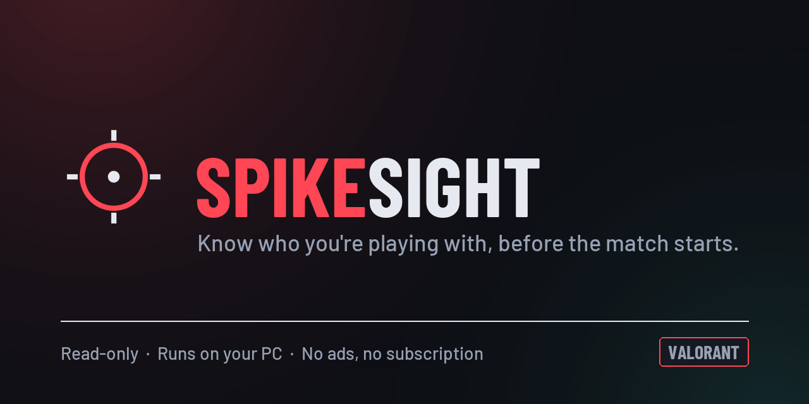
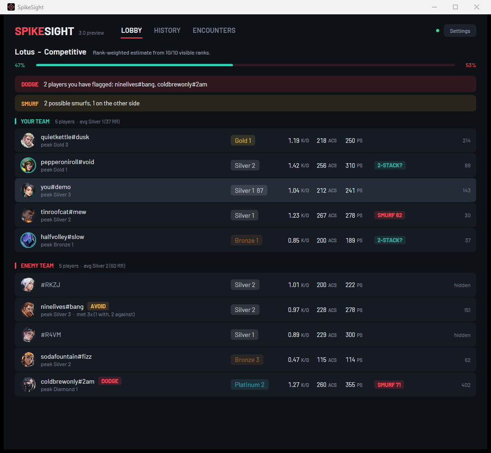
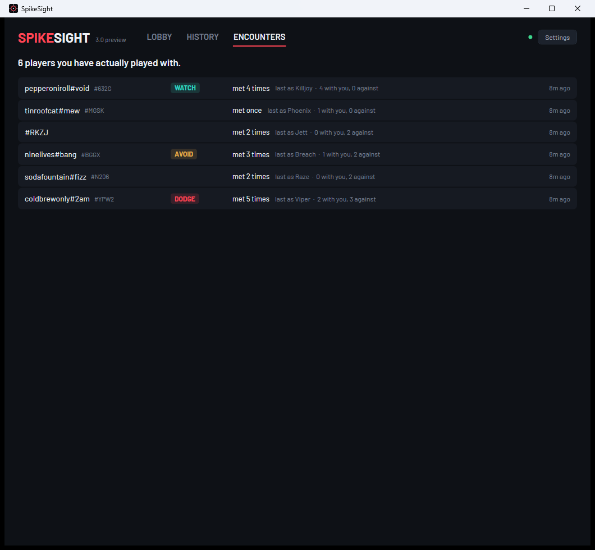
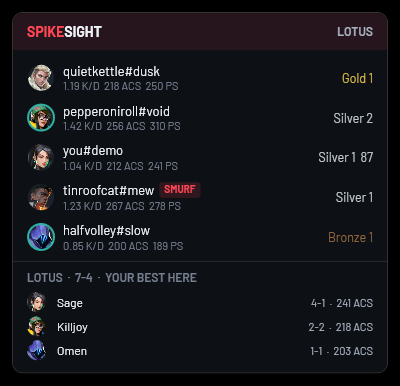
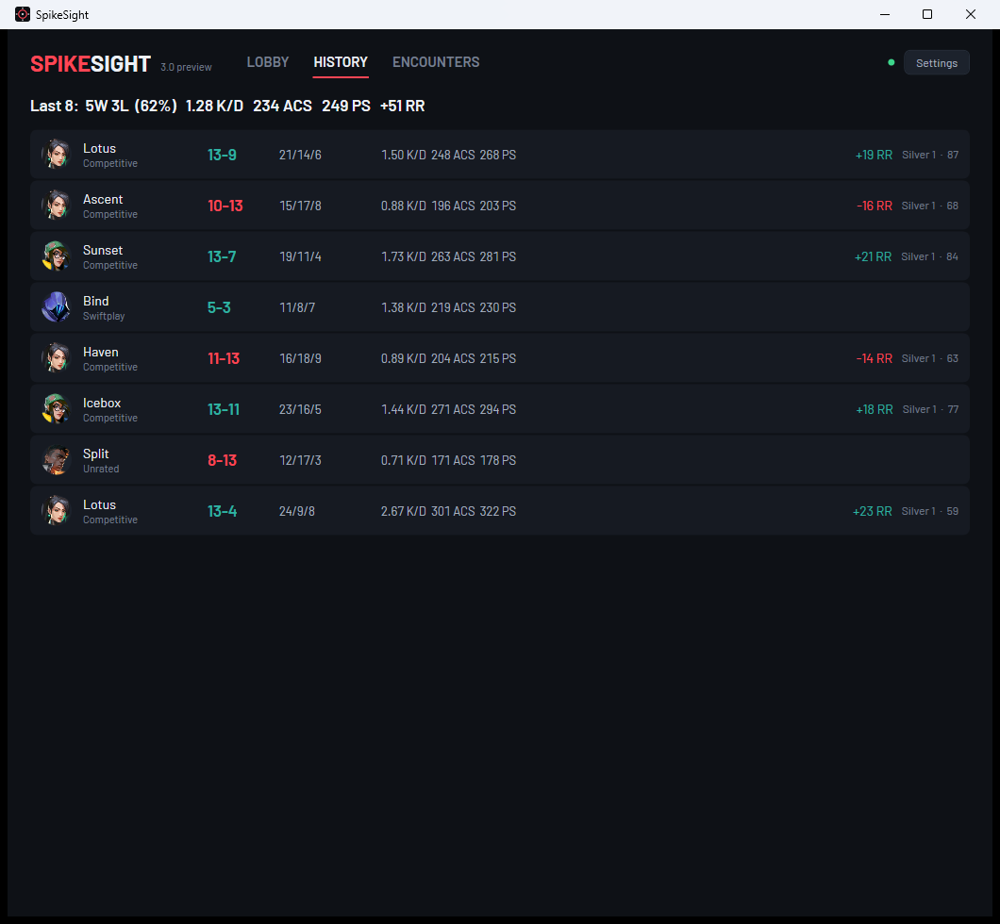
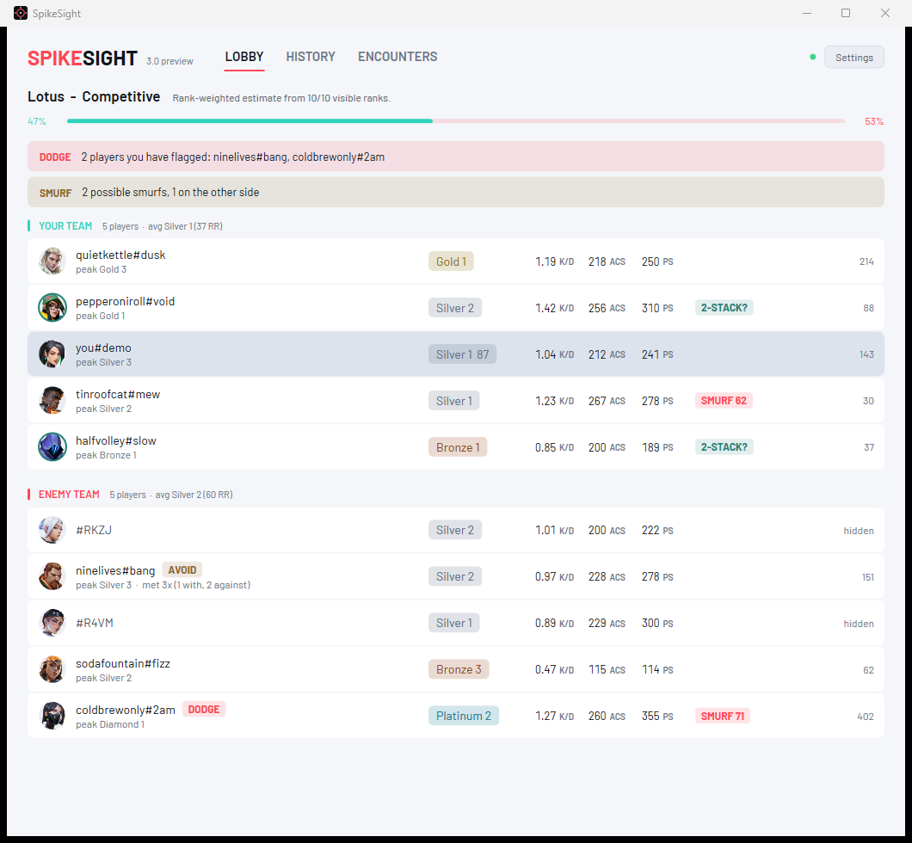

<div align="center">



# SpikeSight

A read-only VALORANT lobby scout for Windows. Ranks, peak ranks, recent form,
party detection, smurf flags, and a private record of players who ruined your
game — on screen the moment agent select loads, while dodging still costs you
nothing.

</div>



---

**Contents** · [What it does](#what-it-does) · [Is this safe to use?](#is-this-safe-to-use)
· [Free, and staying that way](#free-and-staying-that-way) · [Install](#install)
· [Options](#options) · [Performance](#does-it-affect-performance)
· [Verifying the download](#verifying-the-download)
· [Building it yourself](#building-it-yourself) · [License](#license)

---

## What it does

The moment you load into agent select, SpikeSight shows you the lobby:

- **Everyone's rank**, your side and theirs, read at a glance. Your own RR is
  shown; nobody else's is, because the game shows you their rank and not their
  rating, and that reads as deliberate.
- **Peak rank and the act they hit it in**, plus last act's rank and win-loss.
  A Diamond who peaked Immortal two acts ago plays nothing like a Diamond who
  just got there.
- **Recent form** — K/D, average combat score and Performance Score over each
  player's last few matches in the mode you're queued into, not their lifetime
  stats. Performance Score is the number the game itself now ranks the
  end-of-match scoreboard by.
- **Party detection** — who queued together, colour-coded, including 4- and
  5-stacks in the modes that allow them. Confirmed parties and likely ones are
  marked differently, because one is a fact and the other is an inference.
- **Smurf flags** — a score out of 100 from account level, recent K/D, peak
  rank and win rate. Only shown at 50 and above: below that the number is
  noise, and a flag you learn to ignore is worse than no flag.
- **Estimated win probability** for your side, weighted by rank and recent
  form.

### Your own notes on players

Flag anyone as **Watch**, **Avoid** or **Dodge**, with tags and a note. Next
time they show up, the flag is on the board while the dodge window is still
open.



Every completed match is recorded, so you also get a running count of how many
times you've met someone and whether they were with you or against you. A
roster is only logged once the match actually starts — a lobby you dodged was
never an encounter.

Any player whose riot ID is visible has a one-click link out to their full
stats on tracker.gg, for when you want the deep dive. Players in Streamer Mode
get no link, because SpikeSight never resolves their name in the first place.

### The pre-match overlay



An optional panel in the top-right during agent select, with your team, your
win-loss on the map you're about to play, and your best agents on it. It
**cannot be clicked** — it is click-through, so it can never swallow a click
meant for the agent grid — and it disappears when the match starts. It is
never drawn during a round, where it would have nothing to say.

**Ctrl+Alt+S** hides and shows it with the game in front.

Needs VALORANT in **Windowed Fullscreen**; exclusive fullscreen draws over
everything. Off by default.

### Your own match history



RR gained and lost per match, the rank you landed on, K/D/A and ACS over your
recent games.

### And light mode



---

## Is this safe to use?

**Short version:** SpikeSight only ever *reads*, and only from the same local
APIs your own Riot Client already exposes on your machine. There is no code
path in it that can play the game for you.

That said — read this section rather than taking the summary on faith. It is
your account.

### What it does

| | |
|---|---|
| **Reads only** | Every request is a `GET`, with one exception: the batched name lookup Riot only exposes as a `PUT`. It has no side effects — the list of player ids is the query. |
| **Local APIs** | It authenticates with the tokens your Riot Client already minted for you, read from the lockfile on `127.0.0.1`. Your password never touches it, and there is no login flow. |
| **No injection** | Nothing is injected into VALORANT. No game memory is read or written. No DLLs, no hooks, no overlay drawn inside the game process. |
| **No automation** | It cannot queue, dodge, hover, lock an agent, send a message, join a party, or change any setting on your account. Not "it doesn't" — there is no function that does it. |
| **No input simulation** | It never moves your mouse or presses keys. The one keyboard shortcut — Ctrl+Alt+S — is registered with Windows the normal way, so Windows decides when to tell us. It is not a keyboard hook and sees nothing else you type. |
| **Stays local** | No telemetry, no account, no server of mine. Your notes are a SQLite file in `%LOCALAPPDATA%\SpikeSight`, and nothing about you or your matches is uploaded anywhere, ever. |
| **One outbound request** | On startup SpikeSight asks GitHub whether a newer release exists. It sends the version you're on and nothing else — no account, no match data, no identifier — and it never downloads or installs anything by itself. The download is always your click. |

### It respects other players' privacy settings

Riot's per-player privacy flags are enforced in the backend, before the data
reaches the screen — a hidden value is never sent to the UI at all, rather
than hidden with CSS:

- **Streamer Mode** — the riot ID is never even requested from Riot, never
  displayed and never written to disk. The player is shown by agent, with a
  short local code so your own notes can still tell two of them apart. The one
  exception is somebody in your own party, whose name your client already
  handed you.
- **Hidden account level** — not shown, and excluded from smurf scoring. It is
  *not* reconstructed from match history, which would defeat the setting.
- **Hidden act rank badge** — peak rank and previous act are suppressed.
- **Anonymised leaderboard placement** — suppressed.

### The honest caveat

Riot does not publish an approved-tools list, and does not vet third-party
apps. Nobody can promise you that any tool is endorsed, including this one.
What can be said concretely is that SpikeSight does none of the things Riot's
rules actually name — no automation, no injection, no interference with the
game — and that it does nothing the official client doesn't do already.

Use it at your own risk, as you would any third-party tool. If that risk isn't
one you want, don't use it. That's a completely reasonable position.

---

## Free, and staying that way

- **No ads. Ever.** Not in the app, not in the overlay, not anywhere.
- **No premium tier, no subscription, no "pro" unlock.** Everything it does,
  it does for everybody. There is no paid version to upsell you to, and there
  never will be.
- No account to make, no telemetry, nothing about you to sell.

If it saved you from a bad game and you feel like buying me a coffee, there's
a **Sponsor** button at the top of this page — it goes through GitHub
Sponsors, and one-off tips are fine. Entirely optional. Nothing in the app is
gated behind it, no sponsor gets a feature you don't, and that will not
change.

---

## Install

1. Download the latest `SpikeSight-x.y.z-windows.zip` from
   [Releases](../../releases).
2. Unzip it anywhere — Desktop, Documents, wherever.
3. Start VALORANT (or at least the Riot Client).
4. Run `SpikeSight.exe`.

Queue up. The board fills itself in.

**Windows will probably warn you.** A blue "Windows protected your PC" box
appears for any program without a paid code-signing certificate. Click
**More info** → **Run anyway**. See [Verifying the download](#verifying-the-download)
if you'd rather check first.

**To uninstall**, delete the folder. Nothing is written to Program Files, and
the only registry entry is the optional "start with Windows" one, which is
removed when you turn it off.

---

## Options

| | |
|---|---|
| **Pre-match overlay** | The panel over the game during agent select. Ctrl+Alt+S hides and shows it. |
| **Fetch recent-match stats** *(on)* | Powers the K/D, ACS and Performance Score columns and part of the smurf score. Turning it off makes SpikeSight much lighter. |
| **Smurf detection** *(on)* | The smurf score and its flag. |
| **Close to the notification area** | Keeps SpikeSight running by the clock instead of quitting. |
| **Start with Windows** | One entry under your own user account. No admin rights, no service, no scheduled task. |
| **Light mode** | Switches theme without a restart. Dark is the default — this sits beside a game that is dark. |
| **Show the diagnostic panel** | Developer output: what the poller decided, which process holds focus, the roster without names. It is written to the log either way; this only decides whether it is on screen too. |

---

## Does it affect performance?

It shouldn't, and where it might, it is built to lose that argument:

- The whole process runs at **below-normal priority**. When Windows has to
  choose between a scoreboard and a game that needs every frame, it should not
  be choosing us.
- Reading ten players' recent form is the heaviest thing it does, so it
  **waits twelve seconds after a match starts** before doing it. That moment
  is the map loading, which is the one moment the machine has nothing spare.
  Agent select has the time; map load does not. The board itself — ranks and
  names — still appears straight away.
- It is **one process**, and a window that is not changing is not being
  redrawn.

If your frame rate does drop with *any* window open over the game, that's
Windows composing the desktop instead of letting the game draw straight to the
screen — it happens with browsers and chat apps too. Minimizing SpikeSight, or
playing in exclusive fullscreen, is the fix.

---

## Verifying the download

Releases include a `SHA256SUMS.txt`. Check the file you downloaded matches:

```powershell
Get-FileHash .\SpikeSight-3.0.0-preview-windows.zip -Algorithm SHA256
```

Every release is also scanned by [VirusTotal](https://www.virustotal.com); the
report is linked in the release notes.

**A note on antivirus warnings.** Unsigned single-file apps get flagged by
heuristics fairly often — an executable that unpacks a runtime out of itself
looks structurally like packed malware to a scanner that only sees the shape.
If you get a hit and want certainty rather than reassurance, the source is
right here: read it, and [build it yourself](#building-it-yourself).

---

## Building it yourself

Requires the [.NET 8 SDK](https://dotnet.microsoft.com/download/dotnet/8.0) on
Windows. Nothing else — and nothing to install for the built app either, which
is why the download is as large as it is: the runtime ships inside it.

```powershell
git clone https://github.com/spikesight/spikesight-app.git
cd spikesight-app\app
dotnet run --project SpikeSight.App
```

Run the tests:

```powershell
dotnet test
```

To build the same single `.exe` the releases ship. It runs the tests first,
and refuses to run while SpikeSight is open:

```powershell
.\build.ps1
```

---

## Not affiliated with Riot Games

SpikeSight isn't endorsed by Riot Games and doesn't reflect the views of Riot
Games or anyone officially involved in producing or managing Riot Games
properties. Riot Games and all associated properties are trademarks or
registered trademarks of Riot Games, Inc.

## License

[MIT](LICENSE).
